# Crypto Wallet — Dashboard

Aplicação web em **React + TypeScript** para gerenciar uma **carteira de criptoativos**: depósitos, saques, conversão entre moedas com cotação em tempo real, extrato detalhado e um letreiro de cotações de mercado ao vivo.

O frontend consome a API [crypto-wallet-server](https://github.com/MatheusSaleh/crypto-wallet-server) (NestJS + PostgreSQL), que cuida da autenticação, dos saldos e do registro contábil de cada operação.

---

## Sumário

- [Prints](#prints)
- [Funcionalidades](#funcionalidades)
- [Tecnologias](#tecnologias)
- [Como rodar](#como-rodar)
- [Arquitetura](#arquitetura)
- [Integração com a API](#integração-com-a-api)
- [Estrutura do projeto](#estrutura-do-projeto)

---

## Prints

### Login e cadastro

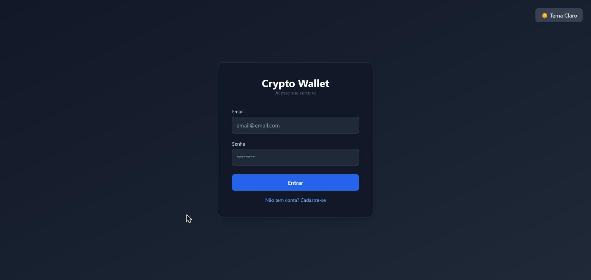

### Dashboard

Resumo da carteira, últimas movimentações e saldos. No topo, o **letreiro de cotações ao vivo** e os saldos do usuário.

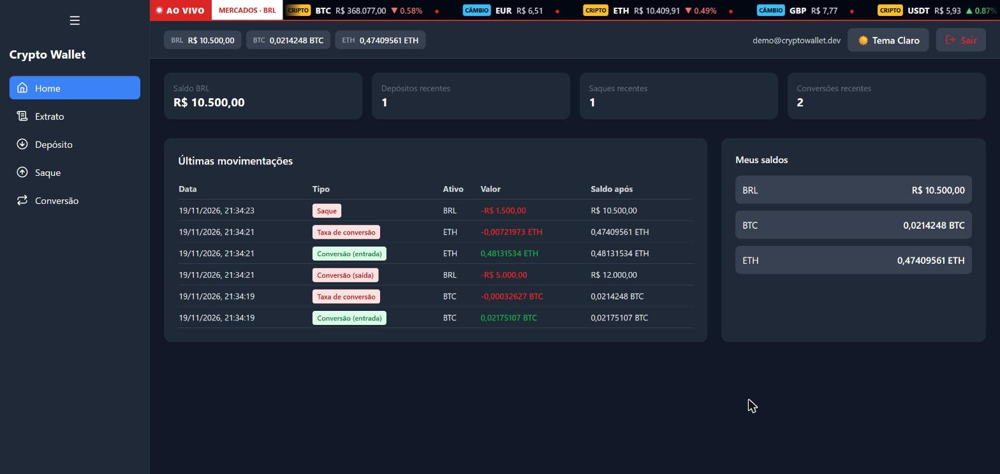

<details>
<summary>Tema claro</summary>

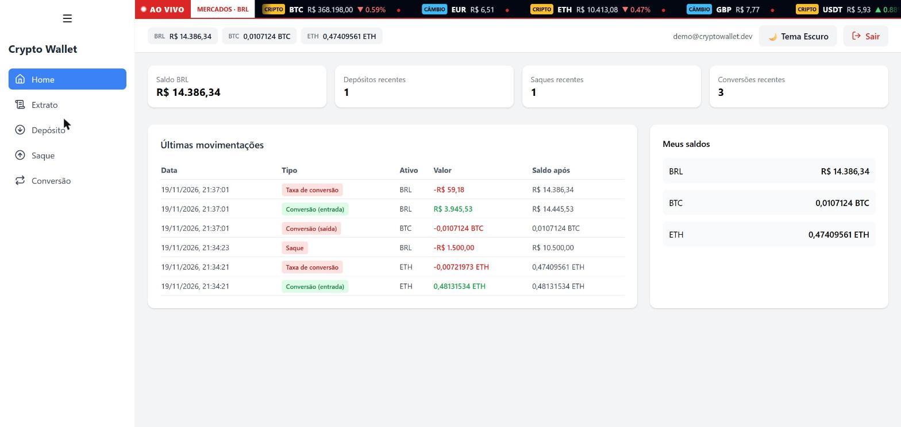

</details>

### Letreiro de cotações e saldos na topbar

Cotação de 12 moedas e 12 criptomoedas em reais, rolando continuamente no estilo de canal de notícias. Pausa ao passar o mouse.

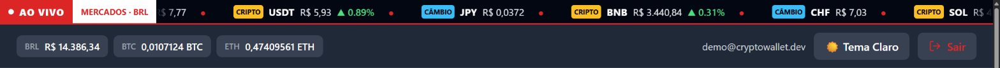

### Conversão de moedas

Tela no estilo de plataforma de câmbio: valor pago e recebido, detalhamento da taxa e impacto no saldo antes de confirmar.

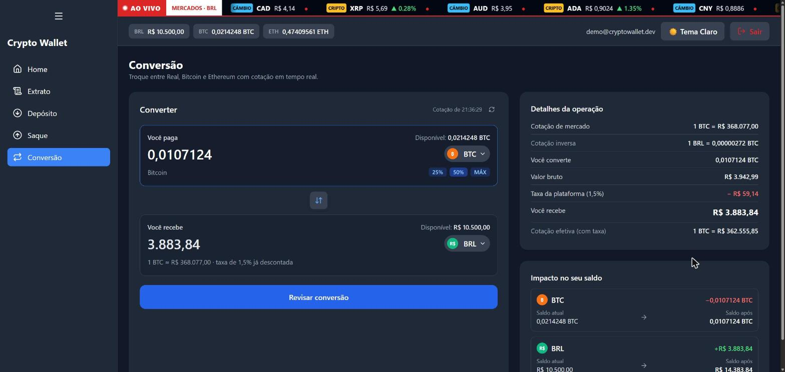

| Revisão antes de confirmar | Comprovante |
| --- | --- |
| 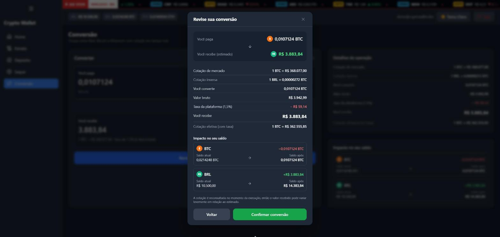 | 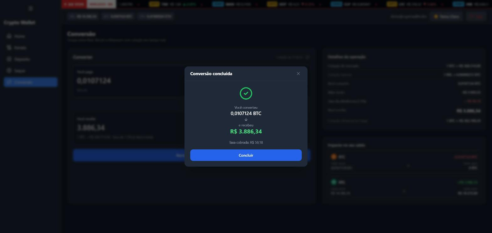 |

**Validação de saldo:** o valor é bloqueado antes de chegar à API, com atalho para depositar.

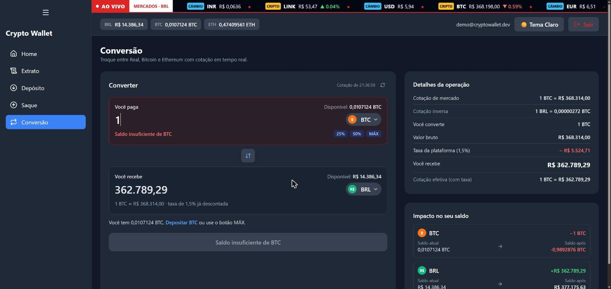

### Extrato

Todas as movimentações do ledger, com saldo após cada lançamento e paginação.

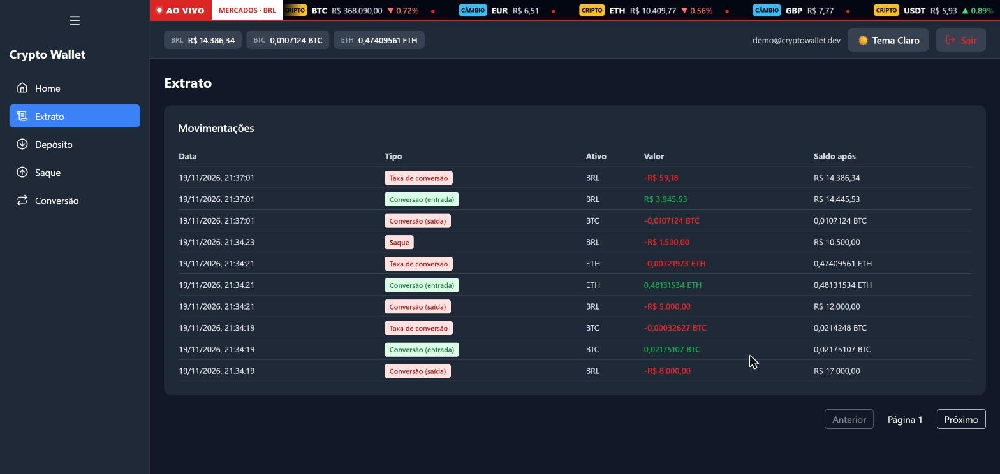

### Depósito e saque

| Depósito | Saque |
| --- | --- |
| 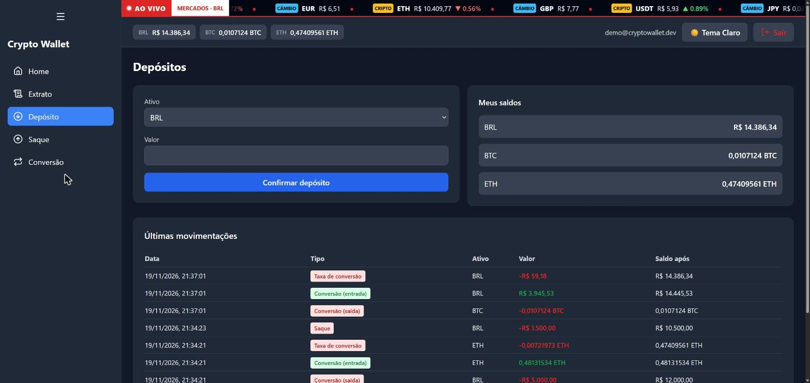 | 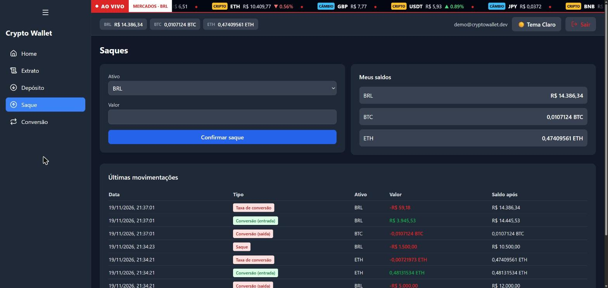 |

---

## Funcionalidades

**Conta**
- Cadastro e login com JWT
- Renovação automática da sessão (refresh token) e logout quando ela expira
- Rotas protegidas: o dashboard só é acessível autenticado

**Carteira**
- Saldos em BRL, BTC e ETH sempre visíveis na topbar
- Depósito e saque com validação de formulário (React Hook Form + Zod)
- Saldos e extrato atualizados automaticamente após cada operação

**Conversão**
- Cotação em tempo real, atualizada a cada 30 s
- Atalhos **25% / 50% / MÁX** e botão para inverter o par
- Detalhamento: cotação de mercado e inversa, valor bruto, taxa, valor líquido e cotação efetiva
- **Saldo antes → saldo depois** para as duas moedas
- Revisão em duas etapas e comprovante ao final
- Bloqueio de saldo insuficiente antes de enviar à API

**Mercado**
- Letreiro animado com 24 cotações (moedas fiduciárias e criptomoedas) e variação de 24h

**Interface**
- Tema claro e escuro (persistido no navegador)
- Layout responsivo com sidebar recolhível
- Feedback com toasts de sucesso e erro

---

## Tecnologias

| Tecnologia | Uso |
| --- | --- |
| **React 19** + **TypeScript** | Interface |
| **Vite 7** | Build e servidor de desenvolvimento |
| **TailwindCSS 3** | Estilização (com dark mode por classe) |
| **TanStack Query 5** | Cache, sincronização e invalidação dos dados da API |
| **Axios** | Cliente HTTP com interceptors de autenticação |
| **React Router 7** | Rotas e proteção de rotas |
| **React Hook Form** + **Zod** | Formulários e validação |
| **React Hot Toast** | Notificações |
| **Lucide React** | Ícones |

---

## Como rodar

### Pré-requisitos

- **Node.js 20+** e **pnpm**
- A API [crypto-wallet-server](https://github.com/MatheusSaleh/crypto-wallet-server) rodando (veja o README dela)

### 1. Clonar e instalar

```bash
git clone https://github.com/MatheusSaleh/crypto-wallet-client
cd crypto-wallet-client
pnpm install
```

### 2. Configurar a URL da API

```bash
cp .env.example .env
```

| Variável | Padrão | Descrição |
| --- | --- | --- |
| `VITE_API_URL` | `http://localhost:3000` | URL base do crypto-wallet-server |

> O backend precisa liberar a origem do frontend no CORS (`CORS_ORIGIN`, padrão `http://localhost:5173`).

### 3. Rodar

```bash
pnpm run dev
```

Acesse **http://localhost:5173**, clique em **"Não tem conta? Cadastre-se"** e crie um usuário. A carteira já nasce com saldo zero em BRL, BTC e ETH; faça um depósito para começar.

### Scripts

| Comando | Descrição |
| --- | --- |
| `pnpm run dev` | Servidor de desenvolvimento |
| `pnpm run build` | Checagem de tipos e build de produção em `dist/` |
| `pnpm run preview` | Serve o build de produção localmente |
| `pnpm run lint` | ESLint |

---

## Arquitetura

### Camada de serviços

Toda chamada HTTP passa por `services/`. O `api.ts` concentra a instância do Axios e a lógica de autenticação, e cada domínio tem seu arquivo (`authService`, `walletService`, `marketService`).

### Estado do servidor com TanStack Query

Os dados da API (saldo, extrato, cotações) não ficam em estado local: são **queries** do TanStack Query, com cache compartilhado entre os componentes. Por isso a topbar, a Home e a tela de conversão mostram sempre o mesmo saldo.

Depósitos, saques e conversões são **mutations** que, ao concluir, invalidam as queries da carteira (`["wallet", ...]`), e todas as telas se atualizam sozinhas.

```plaintext
useBalance()   ──┐
useLedger()    ──┼── queryKey ["wallet", ...] ◄── invalidada por useDeposit / useWithdraw / useSwap
useSwapQuote() ── refetch a cada 30 s
useTicker()    ── refetch a cada 60 s
```

### Autenticação

- `AuthContext` guarda o estado de login e expõe `login`, `register` e `logout`
- Tokens ficam no `localStorage` (`tokenStorage.ts`)
- `ProtectedRoute` redireciona para o login quem não está autenticado

### Cotação local na conversão

A tela de conversão busca no backend apenas o **preço do par** e calcula o restante localmente. A taxa também vem do backend (`fee / price`), então não há regra de negócio duplicada no frontend, e digitar o valor não dispara uma requisição por tecla.

---

## Integração com a API

| Tela | Endpoints |
| --- | --- |
| Login / Cadastro | `POST /auth/login`, `POST /auth/register` |
| Sessão | `POST /auth/refresh`, `GET /users/me` |
| Topbar, Home, Depósito, Saque | `GET /wallet/balance`, `GET /ledger` |
| Depósito | `POST /webhooks/deposit` |
| Saque | `POST /withdraw` |
| Conversão | `GET /swap/quote`, `POST /swap` |
| Extrato | `GET /ledger?page=&limit=` |
| Letreiro | `GET /market/ticker` |

### Renovação de sessão

O access token expira em 15 minutos. Quando uma requisição recebe **401**, o interceptor do Axios:

1. Chama `/auth/refresh` com o refresh token. Se várias requisições falharem ao mesmo tempo, apenas um refresh é feito
2. Salva os novos tokens e **refaz a requisição original** de forma transparente
3. Se o refresh falhar, limpa a sessão e volta para a tela de login

---

## Estrutura do projeto

```plaintext
src
 ├── components
 │    ├── auth
 │    │    └── ProtectedRoute.tsx        # Bloqueia rotas sem login
 │    ├── conversion
 │    │    ├── ConversionCard.tsx        # Tela de troca (orquestra os demais)
 │    │    ├── AssetAmountBox.tsx        # Card "Você paga" / "Você recebe"
 │    │    ├── SwapSummary.tsx           # Detalhamento da operação
 │    │    ├── BalanceImpact.tsx         # Saldo antes → depois
 │    │    ├── ConfirmSwapModal.tsx      # Revisão e comprovante
 │    │    └── AssetBadge.tsx
 │    ├── layout
 │    │    ├── DashboardLayout.tsx
 │    │    ├── TickerTape.tsx            # Letreiro de cotações
 │    │    ├── Header.tsx                # Saldos, tema e logout
 │    │    └── Sidebar.tsx
 │    └── transaction
 │         ├── BalancesTable.tsx
 │         ├── TransactionForm.tsx       # Formulário de depósito/saque
 │         └── TransactionsTable.tsx     # Tabela do ledger
 ├── context
 │    └── AuthContext.tsx
 ├── hooks
 │    ├── useWallet.ts                   # Queries e mutations da carteira
 │    ├── useSwapQuote.ts
 │    ├── useTicker.ts
 │    └── useTheme.ts
 ├── pages
 │    ├── Login · Home · History (Extrato)
 │    └── Deposit · Withdraw · Convert
 ├── router
 │    └── router.tsx
 ├── schemas
 │    └── transactionSchema.ts
 ├── services
 │    ├── api.ts                         # Axios + interceptors de auth
 │    ├── tokenStorage.ts
 │    ├── authService.ts
 │    ├── walletService.ts
 │    └── marketService.ts
 ├── types
 │    ├── transaction.ts
 │    └── user.ts
 └── utils
      ├── assets.ts                      # Metadados dos ativos e formatação
      ├── format.ts
      └── swap.ts                        # Cálculo de bruto, taxa e líquido
```
